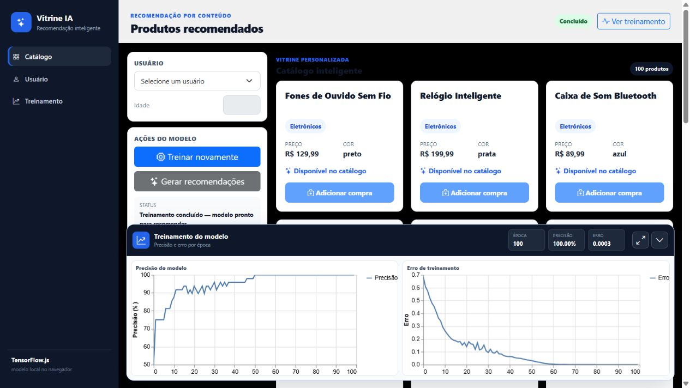
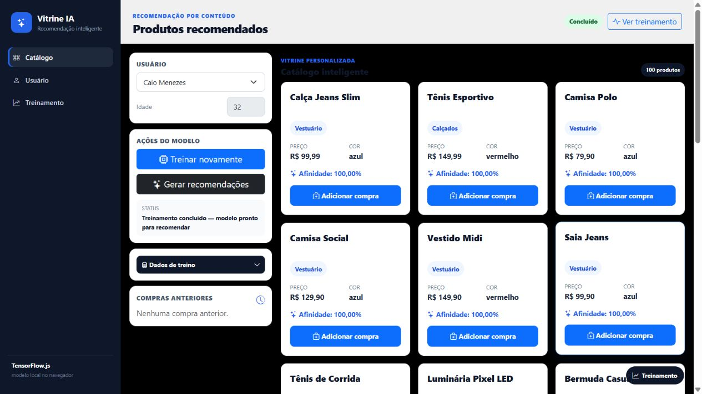
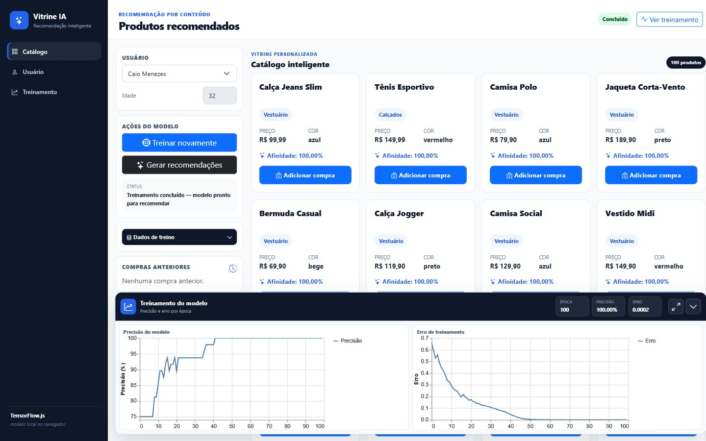
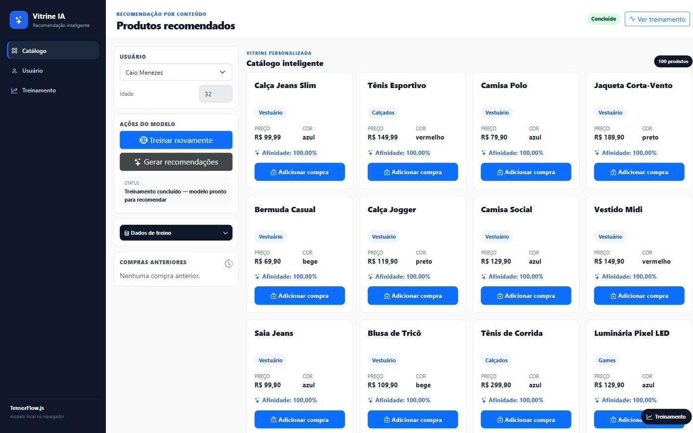

# Ecommerce Recomendações com TensorFlow

Demonstração de recomendações de produtos com uma rede neural treinada no próprio navegador. A página combina catálogo, perfis de usuários, histórico de compras e gráficos de treinamento para mostrar como dados de preferência podem ordenar sugestões.

**Categoria:** Inteligência Artificial (IA) · Machine Learning (ML) · Frontend.

## Tecnologias principais

- JavaScript
- TensorFlow.js 4.22
- Web Workers
- TensorFlow Visor

## O que é possível explorar

- Selecionar um usuário e visualizar seu histórico de compras.
- Consultar o catálogo de produtos carregado de arquivos JSON.
- Treinar o modelo e acompanhar épocas, perda e acurácia na interface.
- Solicitar recomendações e ordenar produtos pela afinidade calculada.
- Observar a mudança das recomendações conforme o perfil selecionado.

## Como o modelo funciona

O treinamento transforma categoria e cor em vetores one-hot, normaliza preço e idade e combina essas características com o perfil do usuário. As compras fornecem exemplos positivos; uma amostra de produtos não comprados fornece exemplos negativos.

A rede contém camadas densas com 128, 64 e 32 unidades, seguidas de uma saída sigmoid. A configuração do exemplo utiliza 100 épocas e lotes de 32. O valor de saída é usado para ordenar a afinidade entre usuário e produto.

Os pesos definidos no preparo das características mudam a escala das entradas. Eles não determinam diretamente a importância que a rede aprenderá para cada atributo. As métricas sobre os dados do exemplo também não comprovam capacidade de generalização em um ecommerce real.

## Arquitetura

O código organiza controladores, serviços e visualizações. O treinamento roda em `src/workers/modelTrainingWorker.js`, separado da interface por Web Worker. Os arquivos `data/products.json` e `data/users.json` fornecem os dados da demonstração.

Frontend, treinamento e recomendação estão neste mesmo repositório. Node.js é utilizado para servir os arquivos no desenvolvimento; não há um backend de treinamento separado nem integração com os projetos Java desta coleção.

## Executar

Com Node.js e npm instalados:

```bash
npm install
npm start
```

O script utiliza BrowserSync na porta 3000. Se ela estiver ocupada, execute em outra porta:

```bash
npx browser-sync start --server --port 4310
```

Abra o endereço mostrado pelo servidor. A aplicação precisa de um servidor HTTP para carregar módulos, dados e o worker; abrir `index.html` diretamente como arquivo não é o fluxo recomendado. O TensorFlow.js é carregado por CDN e depende de acesso à internet.

## Execução das capturas

A aplicação foi servida localmente na porta 4310. O modelo concluiu 100 épocas de treinamento e a interface apresentou recomendações para um perfil de demonstração. Em 13/10/2026 foram coletadas mais duas imagens em 1440 × 900 pixels: uma com os gráficos de precisão e erro e outra com o catálogo, após acionar Gerar recomendações. Os números nas imagens pertencem somente à execução ilustrada, não comprovam desempenho em dados externos. As imagens anteriores foram preservadas.

## Capturas do sistema

Capturas reais obtidas em execução local em 12/10/2026.

### Página inicial



### Recomendações após o treinamento



### Treinamento no enquadramento web



### Catálogo no enquadramento web



## Histórico

Repositório criado no GitHub em **2026-09-11**. Essa data identifica a criação do repositório; não comprova o início nem a conclusão do desenvolvimento.
